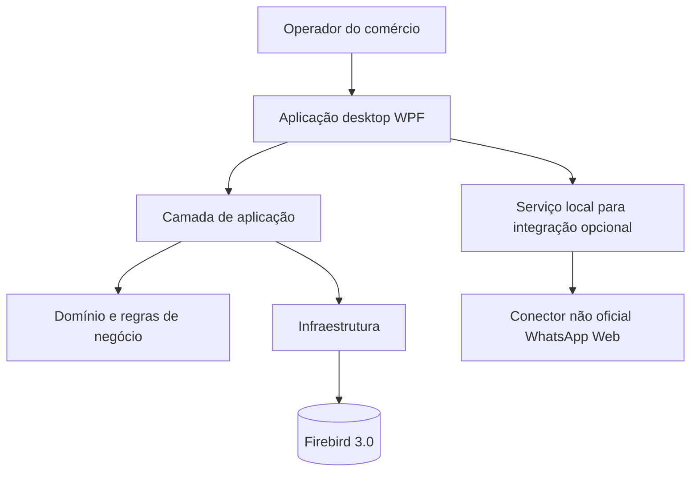

# Arquitetura do VENDRA — visão pública

O VENDRA é um aplicativo desktop para Windows, desenvolvido em C# com .NET 8 e WPF, utilizando Firebird 3.0 para armazenamento de dados.

## Separação de responsabilidades

- **Desktop:** telas, navegação e apresentação.
- **Application:** casos de uso, validações, contratos e serviços de aplicação.
- **Domain:** regras de negócio fundamentais.
- **Infrastructure:** persistência Firebird e integrações concretas.
- **WhatsAppService:** processo separado para monitoramento e comunicação com o conector local.

Essa separação facilita manutenção, testes e evolução dos módulos sem vincular a interface à implementação da persistência.

## Qualidade e limites

O projeto contém testes automatizados para camadas de aplicação, desktop e infraestrutura. Os testes de integração dependentes de banco são executados em ambiente controlado; não se deve inferir que todos foram executados ou aprovados em cada versão.

O conector WhatsApp **não usa a plataforma oficial WhatsApp Business API**. Dependências externas e mudanças no WhatsApp Web podem afetar seu funcionamento. A implantação comercial depende da conclusão das validações do instalador e da operação em ambiente de cliente.

Esta página é uma descrição técnica resumida para apresentação pública e não inclui segredos, configurações internas nem detalhes de implantação do cliente.
