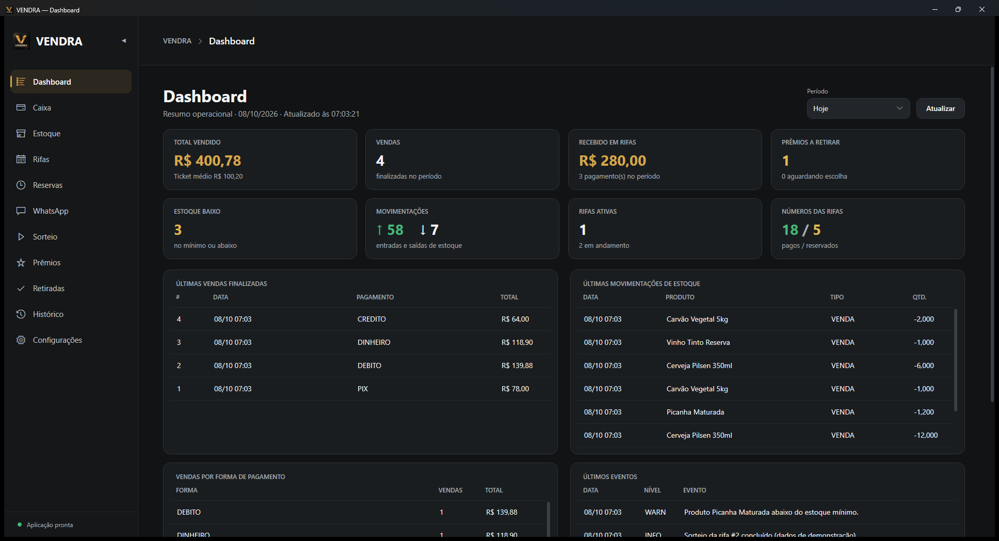
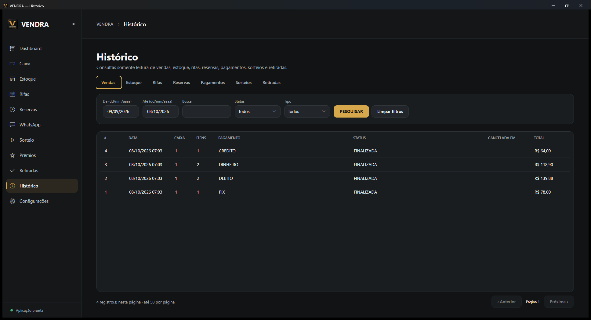
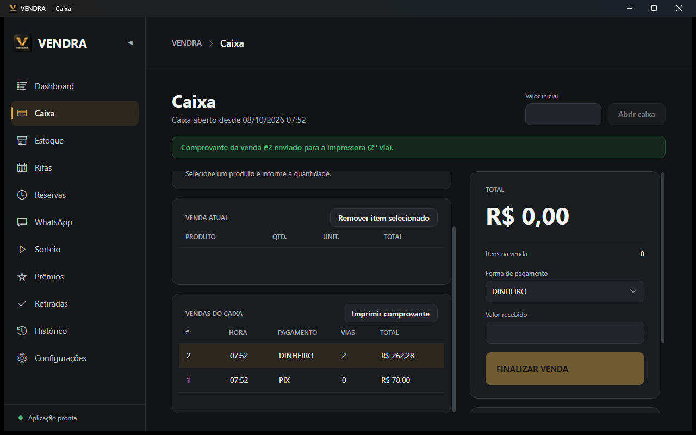

### Um lugar para organizar as operações do seu comércio.

**Vendas e caixa · Controle de estoque · Rifas e sorteios · Reservas e retiradas**

**[Conversar sobre o VENDRA](https://www.linkedin.com/in/arthurkohlerdev/)** · **[Ver informações técnicas](docs/ARQUITETURA-RESUMIDA.md)**

---

## O que é o VENDRA?

O **VENDRA** é um sistema desktop desenvolvido para simplificar a rotina de **pequenos comércios**. Reúne controles de estoque, operações de vendas e caixa, gerenciamento de rifas e sorteios, reservas, prêmios e retiradas em uma única aplicação para Windows.

A proposta é facilitar tarefas do dia a dia sem transformar uma operação de pequeno porte em um processo complicado.

> **Apresentação do produto:** este repositório é uma vitrine pública. O código-fonte, o banco de dados e os componentes de desenvolvimento do VENDRA permanecem em um repositório privado.

## O que o sistema oferece

| Módulo | Funcionalidades contempladas no projeto |
| --- | --- |
| **Dashboard** | Visão geral para acompanhar as operações. |
| **Estoque** | Controle de produtos, saldo e movimentações. |
| **Vendas e caixa** | Registro das vendas, operações de caixa e emissão de comprovantes. |
| **Rifas e reservas** | Organização de rifas, números e reservas de participantes. |
| **Prêmios e sorteios** | Cadastro das opções de prêmios, apresentação e resultado do sorteio. |
| **Pagamentos e retiradas** | Controle de confirmações e acompanhamento dos prêmios retirados ou pendentes. |
| **Histórico** | Consulta a registros de movimentações e operações. |
| **WhatsApp (integração não oficial)** | Recursos de publicação e leitura de reservas em grupos, sujeitos às limitações da integração. |

As funcionalidades acima representam módulos implementados e documentados no projeto; **não constituem declaração de homologação comercial de todos os fluxos**.

## Para quem foi pensado

O VENDRA foi idealizado para negócios que precisam de um sistema direto e adaptado à própria rotina, como lojas de bairro, empórios e pequenos estabelecimentos comerciais que organizam estoque, vendas e campanhas com prêmios.

## Visual do produto

A interface utiliza tema **grafite escuro com detalhes dourados**, com foco na leitura das informações e na navegação entre os módulos.

> **Capturas reais em revisão.** Para publicar imagens, substitua os exemplos de demonstração pelos arquivos aprovados, sem dados pessoais, números de telefone, credenciais ou informações de clientes. Consulte [o guia de imagens](assets/screenshots/README.md).

  <h3>Dashboard</h3>
  

  <h3>Histórico de operações</h3>
  

  <h3>Caixa e vendas</h3>
  

## Tecnologia e arquitetura

O VENDRA é construído com tecnologias adequadas a uma aplicação desktop para Windows:

- **C# e .NET 8** para regras de negócio e aplicação;
- **WPF** para a interface gráfica;
- **Firebird 3.0** para persistência;
- **Arquitetura em camadas**, separando apresentação, aplicação, domínio e infraestrutura;
- **Testes automatizados** para fluxos e componentes do sistema.

A integração opcional com grupos do WhatsApp utiliza um conector local baseado no WhatsApp Web. **Não é uma integração oficial da Meta/WhatsApp** e pode apresentar falhas de compatibilidade, indisponibilidade ou restrições de conta.

Veja [a arquitetura resumida](docs/ARQUITETURA-RESUMIDA.md) e [o estado de implantação](docs/STATUS-DO-PRODUTO.md).

## Status do produto

**Em desenvolvimento e preparação para implantação comercial.** Há módulos implementados e fluxos documentados, porém o instalador completo com provisionamento do banco para um Windows limpo e os testes finais de implantação ainda estão pendentes de homologação.

Por isso, **não há download público do instalador** nesta vitrine. Demonstrações e disponibilidade devem ser confirmadas diretamente com o desenvolvedor.

## Quer conhecer o VENDRA?

Se você administra um pequeno comércio e deseja conhecer a proposta, entre em contato para conversar sobre necessidades, demonstrações e disponibilidade.

**[Contato pelo LinkedIn — Arthur Kohler](https://www.linkedin.com/in/arthurkohlerdev/)**

---

VENDRA · Projeto de Arthur Kohler / Kohler System. Apresentação pública; código-fonte proprietário. Todos os direitos reservados. O uso de campanhas e sorteios deve respeitar a legislação aplicável.
